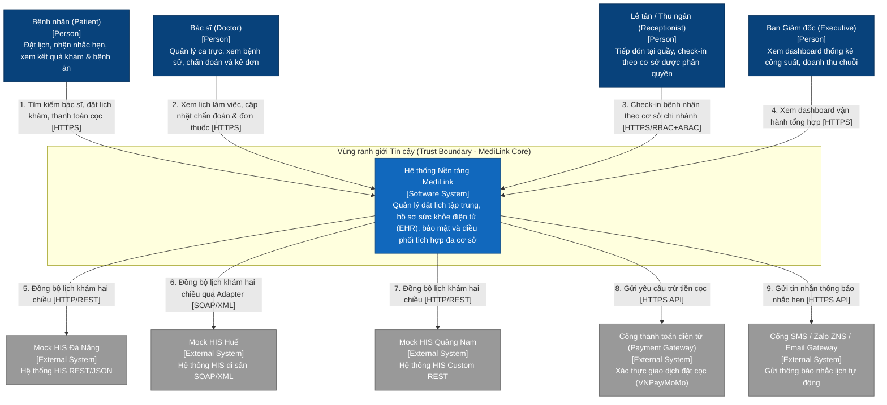
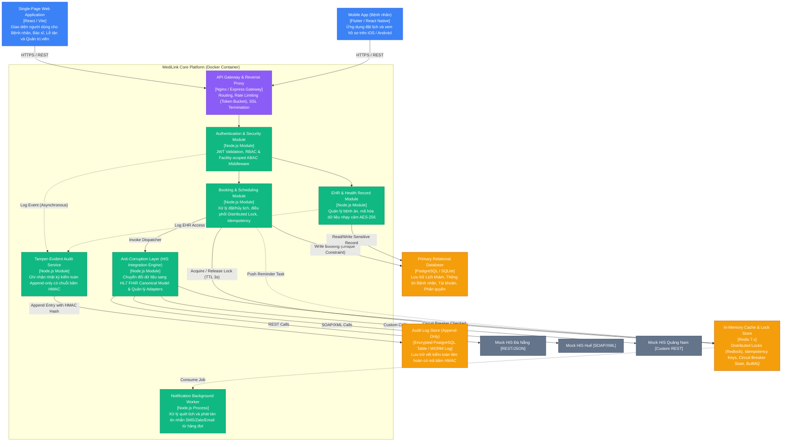
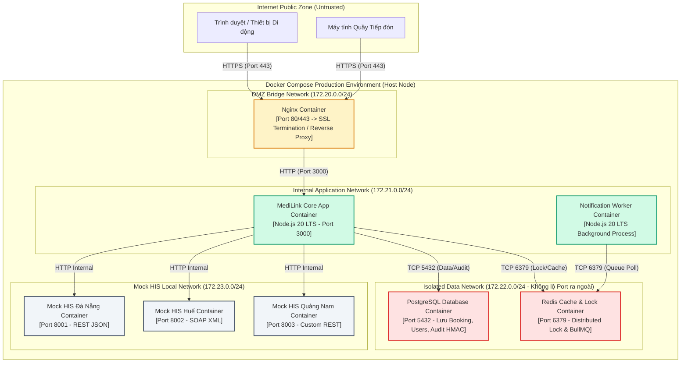
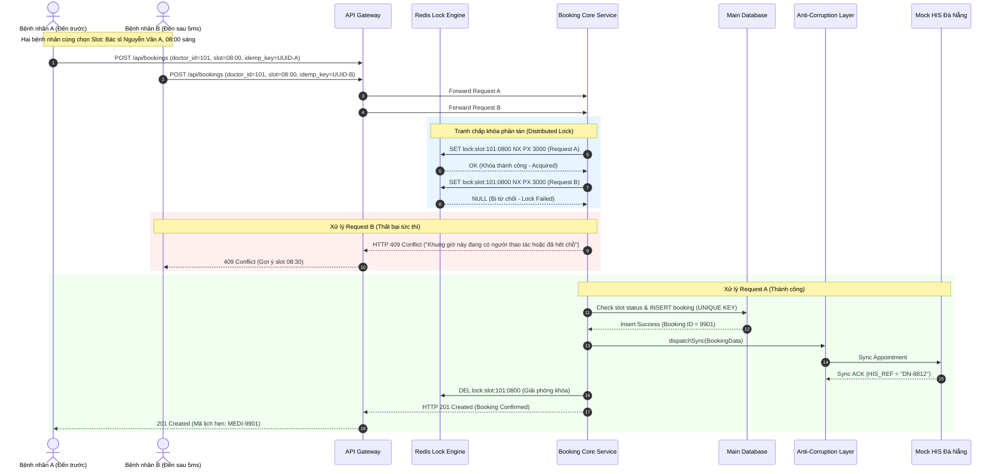
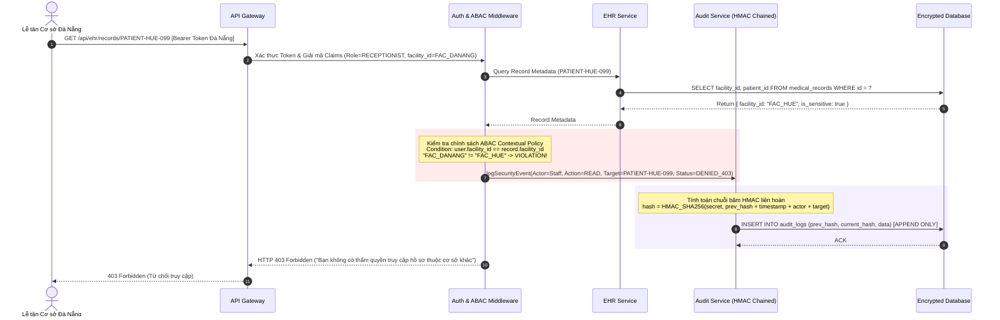

# M2 – Architecture Design v1: Hệ thống MediLink

## 1. Lựa chọn Kiến trúc và Tactics cho từng ASR (Architectural Tactics Selection)

Dựa trên danh mục kiến trúc chuẩn của Len Bass, Paul Clements và Rick Kazman (*Software Architecture in Practice*), nhóm tiến hành lựa chọn các architectural tactics phù hợp nhất cho 4 ASR cốt lõi mức (H, H) đã xác định tại M1.

---

### 1.1. Tactics cho ASR-01: Chống đặt trùng lịch (Consistency & Concurrency)

- **Mục tiêu:** Đảm bảo khi 50 request cùng gửi lệnh đặt cùng 1 slot khám của 1 bác sĩ, chỉ có duy nhất 1 booking thành công (double-booking = 0%).
- **Các Tactics ứng viên được cân nhắc:**
  1. *Pessimistic Locking (Khóa bi quan tại RDBMS):* Sử dụng câu lệnh `SELECT ... FOR UPDATE` trên hàng dữ liệu của slot khám trong Database.
     - *Ưu điểm:* Dễ hiện thực trên cơ sở dữ liệu quan hệ, đảm bảo tính nhất quán tuyệt đối của ACID transaction.
     - *Nhược điểm:* Giữ lock database lâu, dễ gây nghẽn kết nối (connection pool exhaustion), giảm nghiêm trọng thông lượng ghi khi có nhiều request đồng thời; không mở rộng được khi có nhiều replica database hoặc ứng dụng phân tán.
  2. *Optimistic Locking (Khóa lạc quan với phiên bản Version/Timestamp):* Bổ sung cột `version` vào bảng slot, khi update kiểm tra `WHERE id = ? AND version = ?`.
     - *Ưu điểm:* Không khóa tài nguyên trong quá trình đọc và xác thực, thông lượng cao khi tỷ lệ tranh chấp thấp.
     - *Nhược điểm:* Khi có tranh chấp cao (50 người cùng giành 1 slot), 49 người sẽ bị fail liên tiếp dẫn đến hiện tượng tải giả tạo (retry storm), lãng phí tài nguyên CPU tính toán nghiệp vụ trước khi phát hiện xung đột ở bước ghi cuối cùng.
  3. *Distributed Lock (Khóa phân tán trên In-memory Store - Redis) kết hợp Idempotency Key & DB Unique Constraint:* Trước khi kiểm tra và ghi nhận lịch, tiến trình phải giành được Distributed Lock trên Redis với khóa duy nhất `lock:slot:{doctor_id}:{slot_time}` có TTL ngắn (3-5 giây). Sau khi giữ lock thành công, kiểm tra trạng thái slot, ghi nhận booking vào DB với ràng buộc duy nhất `UNIQUE(doctor_id, slot_time)` và phát hành Idempotency Key.
- **Tactic được lựa chọn:** **Distributed Lock (Redis Redlock Pattern) đa tầng kết hợp RDBMS Unique Constraint và Idempotency Key.**
- **Biện luận:** Tactic này chặn đứng xung đột ngay tại cửa ngõ bộ nhớ trong (In-Memory) với độ trễ tính bằng mili-giây (< 2ms), loại bỏ hoàn toàn tải tranh chấp vào RDBMS. Ràng buộc `UNIQUE` ở tầng Database đóng vai trò là chốt chặn cuối cùng (Last-mile defense), loại trừ rủi ro do trễ mạng hoặc lỗi phần mềm.

> **Tự kiểm tra Bước 7 (ASR-01): Tactic đã chọn ảnh hưởng tiêu cực tới QA nào khác?**
> *Trả lời:* Tactic Distributed Lock gây ảnh hưởng tiêu cực đến **Performance / Latency** đối với các request đến sau (phải chờ giải phóng lock hoặc bị từ chối ngay lập tức) và làm tăng độ phức tạp trong bảo trì **Availability** vì hệ thống giờ đây phụ thuộc thêm vào tính sẵn sàng của cụm Redis. Nếu Redis gặp sự cố, luồng lock có thể bị gián đoạn. Nhóm giải quyết bằng cách thiết lập TTL tự động giải phóng lock sau 3 giây và cấu hình Redis Sentinel dự phòng.

---

### 1.2. Tactics cho ASR-02: Cách ly sự cố HIS cơ sở (Availability & Fault Tolerance)

- **Mục tiêu:** Khi HIS của cơ sở Huế sập hoặc mất kết nối 2 giờ, 11 cơ sở còn lại vẫn vận hành bình thường, độ sẵn sàng toàn hệ thống đạt ≥ 99.5%.
- **Các Tactics ứng viên được cân nhắc:**
  1. *Active Redundancy / Replication (Dự phòng nóng hai máy chủ):* Yêu cầu phía phòng khám Huế trang bị cụm máy chủ dự phòng kép.
     - *Đánh giá:* Bất khả thi vì HIS Huế là hệ thống di sản do đơn vị địa phương tự vận hành, vượt quá quyền kiểm soát và ngân sách của dự án MediLink.
  2. *Retries with Exponential Backoff (Thử lại với độ lùi lũy thừa):* Tự động gọi lại HIS khi gặp timeout.
     - *Đánh giá:* Khi HIS Huế sập hoàn toàn trong 2 giờ, việc gọi lại liên tục sẽ làm nghẽn toàn bộ luồng kết nối (Thread pool exhaustion) của MediLink, dẫn tới sập dây chuyền (Cascading Failure).
  3. *Circuit Breaker kết hợp Graceful Degradation & Asynchronous Outbox:* Bọc các cuộc gọi sang từng HIS bằng bộ ngắt mạch Circuit Breaker riêng biệt (ngưỡng 50% lỗi trong 10 giây sẽ OPEN mạch). Khi mạch OPEN, request được trả về ngay lập tức với thông báo lỗi rõ ràng (Fast-fail); đồng thời các yêu cầu đặt lịch được ghi nhận vào hàng đợi ngoại tuyến (Outbox Queue) để đồng bộ lại khi kết nối phục hồi.
- **Tactic được lựa chọn:** **Circuit Breaker (State: Closed, Open, Half-Open) + Bulkhead + Graceful Degradation.**
- **Biện luận:** Tactic này cô lập hoàn toàn sự cố tại từng cơ sở chi nhánh (áp dụng Bulkhead pattern - ngăn tràn khoang thuyền). Sự cố tại phòng khám Huế chỉ khiến mạch của riêng phòng khám Huế bị ngắt (OPEN), tuyệt đối không ảnh hưởng đến tài nguyên xử lý của 11 phòng khám còn lại.

> **Tự kiểm tra Bước 7 (ASR-02): Tactic đã chọn ảnh hưởng tiêu cực tới QA nào khác?**
> *Trả lời:* Tactic này đánh đổi thuộc tính **Data Consistency (Tính nhất quán tức thời)** để lấy **Availability**. Khi HIS Huế bị ngắt kết nối, lịch khám ghi nhận trên MediLink sẽ không được đồng bộ tức thời xuống máy chủ cục bộ của phòng khám Huế mà phải lưu tạm ở hàng đợi bất đồng bộ. Điều này chấp nhận trạng thái nhất quán muộn (Eventual Consistency) và cần quy trình đối soát tự động khi HIS Huế online trở lại.

---

### 1.3. Tactics cho ASR-03: Ngăn chặn truy cập trái phép hồ sơ y tế (Security & Privacy)

- **Mục tiêu:** Lễ tân cơ sở Đà Nẵng không thể truy cập hồ sơ bệnh án của bệnh nhân cơ sở Huế (Trả về HTTP 403 Forbidden và ghi log kiểm toán 100%).
- **Các Tactics ứng viên được cân nhắc:**
  1. *Role-Based Access Control (RBAC đơn thuần):* Phân quyền theo vai trò (Bệnh nhân, Bác sĩ, Lễ tân, Quản trị viên).
     - *Đánh giá:* Không đủ đáp ứng yêu cầu. Lễ tân Đà Nẵng và Lễ tân Huế đều cùng chung vai trò `RECEPTIONIST`. Nếu chỉ dùng RBAC, lễ tân Đà Nẵng vẫn có thể xem được dữ liệu bệnh nhân Huế.
  2. *Attribute-Based Access Control (ABAC - Kiểm soát truy cập dựa trên thuộc tính ngữ cảnh):* Đánh giá động các thuộc tính: `Subject.facility_id`, `Resource.facility_id`, `Action`, `Environment.time`.
     - *Đánh giá:* Rất mạnh mẽ và linh hoạt, cho phép định nghĩa chính sách: "Chỉ cho phép đọc khi `Subject.facility_id == Resource.facility_id` hoặc khi có sự ủy quyền rõ ràng của bệnh nhân".
  3. *Append-Only Audit Logging với HMAC Cryptographic Hash Chain:* Mọi truy vấn đọc/ghi đều tạo ra một log entry có băm chuỗi bảo vệ toàn vẹn.
- **Tactic được lựa chọn:** **Hybrid Access Control (RBAC kết hợp Contextual ABAC Policy Engine) + Authorize Actors + Tamper-evident Audit Logging.**
- **Biện luận:** RBAC giúp quản lý phân quyền theo nhóm nghiệp vụ cơ bản, trong khi ABAC giải quyết ranh giới phân tách dữ liệu địa lý đa cơ sở (Multi-facility isolation). Lớp kiểm toán bất biến bảo đảm tính không thể chối bỏ (Non-repudiation) theo Nghị định 13/2023/NĐ-CP.

> **Tự kiểm tra Bước 7 (ASR-03): Tactic đã chọn ảnh hưởng tiêu cực tới QA nào khác?**
> *Trả lời:* Việc kiểm tra ABAC và tính toán mã băm HMAC cho Audit Log tại mỗi request sẽ làm tăng nhẹ **Latency / Performance** (khoảng 5-10ms) và làm tăng dung lượng lưu trữ (**Storage Cost**). Nhóm khắc phục bằng cách sử dụng bất đồng bộ (Asynchronous worker) để ghi nhận Audit Log vào hàng đợi và tính toán chuỗi băm mà không làm nghẽn luồng xử lý chính của người dùng.

---

### 1.4. Tactics cho ASR-04: Tích hợp HIS mới không sửa Core (Interoperability & Modifiability)

- **Mục tiêu:** Tích hợp phần mềm HIS thứ 4 trong ≤ 2 tuần công (≤ 10 ngày làm việc) mà không cần chỉnh sửa bất kỳ dòng code nào trong Core Domain.
- **Các Tactics ứng viên được cân nhắc:**
  1. *Direct Integration (Gọi trực tiếp từng HIS trong Core Service):*
     - *Đánh giá:* Vi phạm nghiêm trọng nguyên tắc Low Coupling và Single Responsibility. Mỗi lần thêm HIS mới phải sửa đổi mã nguồn Core, kiểm thử lại toàn bộ hệ thống (Regression risk cao).
  2. *Enterprise Service Bus (ESB):*
     - *Đánh giá:* Quá cồng kềnh, chi phí bản quyền và vận hành hạ tầng rất lớn, không phù hợp với quy mô chuỗi 12 phòng khám.
  3. *Anti-Corruption Layer (ACL) kết hợp Adapter Pattern & Canonical Data Model (HL7 FHIR):* Định nghĩa một giao diện chuẩn trừu tượng (`IHisAdapter`) và mô hình dữ liệu chung (Canonical Model) chuẩn hóa theo chuẩn y tế HL7 FHIR (`Appointment`, `Patient`, `Observation`). Mỗi HIS cụ thể sẽ có một Adapter riêng chuyển đổi dữ liệu hai chiều.
- **Tactic được lựa chọn:** **Anti-Corruption Layer (ACL) + Adapter Pattern + Canonical Data Model (HL7 FHIR R4).**
- **Biện luận:** Tactic này tách biệt hoàn toàn miền nghiệp vụ cốt lõi (Core Domain) khỏi sự hỗn loạn và biến dị của các hệ thống ngoài (Domain-Driven Design). Khi có HIS mới, lập trình viên chỉ cần tạo 1 Adapter mới kế thừa `IHisAdapter` và đăng ký vào Factory, Core không hề bị tác động.

> **Tự kiểm tra Bước 7 (ASR-04): Tactic đã chọn ảnh hưởng tiêu cực tới QA nào khác?**
> *Trả lời:* Việc chuyển đổi dữ liệu qua lại giữa định dạng riêng của từng HIS sang Canonical Model (HL7 FHIR) sẽ làm tăng **CPU overhead** và làm tăng nhẹ độ trễ tuần tự hóa/giải tuần tự hóa (Serialization/Deserialization Latency). Tuy nhiên, độ trễ này chỉ chiếm dưới 3ms, hoàn toàn đánh đổi xứng đáng để có được khả năng mở rộng và bảo trì vượt trội.

---

## 2. Lựa chọn Phong cách Kiến trúc Tổng thể (Architectural Style Selection)

Để đưa ra quyết định kiến trúc khách quan, nhóm tiến hành lập bảng so sánh và phân tích đánh giá đa tiêu chí giữa 3 phong cách kiến trúc tiềm năng:
1. **Phương án A: Microservices Architecture thuần túy** (Tách riêng Booking Service, EHR Service, Patient Service, Notification Service, Integration Service thành các tiến trình độc lập với cơ sở dữ liệu riêng biệt).
2. **Phương án B: Monolith truyền thống dạng khối dính liền** (Single deployable unit, shared database, mã nguồn gom chung).
3. **Phương án C: Modular Monolith kết hợp Hexagonal / Ports-and-Adapters Architecture** (Kiến trúc đơn khối phân module nghiêm ngặt, ranh giới domain rõ ràng, lớp tích hợp ACL dạng Adapter độc lập, sẵn sàng tách tiến trình khi cần).

### Bảng so sánh và Đánh giá theo ASR và Bối cảnh dự án

| Tiêu chí / ASR | Trọng số | Monolith truyền thống | Microservices thuần túy | Modular Monolith + Hexagonal (Lựa chọn) |
|:---|:---:|:---:|:---:|:---:|
| **ASR-01: Consistency & Concurrency** (Chống double-booking) | 25% | **4/5** (ACID DB đơn giản, dễ lock nội bộ) | **2/5** (Giao dịch phân tán 2PC/Saga rất phức tạp, rủi ro race condition) | **5/5** (Xử lý tập trung qua Redis Lock + DB Unique Constraint, nhất quán mạnh) |
| **ASR-02: Availability & Fault Tolerance** (Cách ly HIS Huế) | 25% | **2/5** (Một module treo có thể làm sập cả tiến trình) | **5/5** (Cách ly hoàn toàn tiến trình độc lập) | **4.5/5** (Áp dụng Circuit Breaker, Worker Pool riêng cho Adapter, cách ly lỗi tuyệt đối) |
| **ASR-03: Security & Data Privacy** (RBAC/ABAC, Audit Log) | 20% | **3/5** (Dễ bị bypass logic, khó phân định ranh giới) | **3.5/5** (Quản lý phân tán token, network segmentation phức tạp) | **4.5/5** (Middleware tập trung, ranh giới rõ ràng, audit chain bảo mật cao) |
| **ASR-04: Modifiability & Interoperability** (Thêm HIS mới) | 15% | **2/5** (Mã nguồn dễ bị dính chặt, vi phạm OCP) | **4.5/5** (Thêm 1 microservice mới cho HIS mới) | **5/5** (Thêm Adapter class mới tuân thủ interface, zero touch Core) |
| **Chi phí vận hành & Độ phức tạp triển khai (15 tuần, nhóm 4 người)** | 15% | **5/5** (Rất dễ dựng, không tốn hạ tầng) | **1.5/5** (Quá phức tạp: Service Mesh, Distributed Tracing, K8s, DevOps quá tải) | **4.5/5** (Triển khai 1 container Docker compose gọn nhẹ, cấu trúc mã nguồn rành mạch) |
| **TỔNG ĐIỂM CÓ TRỌNG SỐ** | **100%** | **3.10 / 5.0** | **3.05 / 5.0** | **4.65 / 5.0 (VƯỢT TRỘI)** |

> **Quyết định Phong cách Kiến trúc:** Nhóm quyết định lựa chọn **Modular Monolith với kiến trúc Hexagonal (Ports-and-Adapters)**. Lựa chọn này kết hợp được ưu điểm lớn nhất của Monolith (tính nhất quán mạnh, độ trễ giao tiếp thấp, dễ kiểm thử và triển khai bằng 1 lệnh docker compose) với ưu điểm lớn nhất của Microservices (tính module hóa, ranh giới domain rõ ràng, khả năng mở rộng Adapter linh hoạt mà không chạm Core).

---

## 3. Các Khung nhìn Kiến trúc (C4 Architecture Views & Deployment View)

### 3.1. C4 Level 1: System Context View (Bối cảnh hệ thống)

Sơ đồ ngữ cảnh định nghĩa ranh giới hệ thống MediLink, các tác nhân bên ngoài và các hệ thống liên kết.



**Legend (Chú giải C4 Level 1):**
- **Person (Màu xanh đậm):** Người dùng hệ thống có danh tính đã xác thực.
- **System (Màu xanh dương sáng):** Nền tảng MediLink nằm trong ranh giới tin cậy (Trust Boundary).
- **External System (Màu xám):** Hệ thống độc lập của bên thứ ba, nằm ngoài quyền kiểm soát trực tiếp của MediLink. Mọi kết nối đi ra ngoài đều phải qua lớp bảo vệ.

---

### 3.2. C4 Level 2: Container View (Mức tiến trình và Lưu trữ)

Sơ đồ Container mô tả các khối phần mềm có thể triển khai (deployable units) cấu thành nên nền tảng MediLink.



**Legend (Chú giải C4 Level 2):**
- **Client Tier:** Web/Mobile Apps giao tiếp qua kênh an toàn HTTPS.
- **Core Platform:** Chạy trong container Docker chuẩn hóa, ranh giới giữa các module được phân định nghiêm ngặt qua Dependency Injection.
- **Data Tier:** Phân tách rõ ràng giữa In-memory Cache/Lock (Redis), Database Nghiệp vụ (PostgreSQL) và Bảng Audit Log Append-Only được mã hóa.

---

### 3.3. C4 Level 3: Component View (Thành phần Lớp Tích hợp - Anti-Corruption Layer)

Lớp Anti-Corruption Layer (ACL) là "trái tim" giải quyết tính không đồng nhất của chuỗi phòng khám.

```mermaid
graph TD
    classDef coreComp fill:#10b981,stroke:#047857,color:#fff;
    classDef aclComp fill:#0284c7,stroke:#0369a1,color:#fff;
    classDef extHis fill:#64748b,stroke:#334155,color:#fff;

    BookingService["BookingService<br/>(Core Domain Logic)"]:::coreComp

    subgraph ACL[" Anti-Corruption Layer (ACL) & HIS Integration Engine "]
        HisDispatcher["HisIntegrationDispatcher<br/>[Component]<br/>Điều phối yêu cầu đến đúng Adapter theo facility_id"]:::aclComp
        CircuitBreakerManager["CircuitBreakerManager<br/>[Component]<br/>Quản lý trạng thái Closed/Open/Half-Open cho từng cơ sở"]:::aclComp
        CanonicalModelMapper["CanonicalModelMapper (HL7 FHIR)<br/>[Component]<br/>Chuyển đổi dữ liệu nội bộ <-> HL7 FHIR Resource (Appointment/Patient)"]:::aclComp

        IHisAdapter["<<Interface>><br/>IHisIntegrationAdapter<br/>+syncAppointment(fhirAppt)<br/>+cancelAppointment(apptId)<br/>+getDoctorAvailability(doctorId, date)"]:::aclComp

        DaNangAdapter["DaNangHisJsonAdapter<br/>[Adapter Implementation]<br/>Mapping FHIR <-> DaNang REST JSON payload"]:::aclComp
        HueAdapter["HueHisXmlAdapter<br/>[Adapter Implementation]<br/>Mapping FHIR <-> Hue SOAP/XML envelope"]:::aclComp
        QuangNamAdapter["QuangNamHisAdapter<br/>[Adapter Implementation]<br/>Mapping FHIR <-> Quang Nam Custom JSON payload"]:::aclComp
    end

    HIS_A["Mock HIS Đà Nẵng API<br/>[REST / JSON]"]:::extHis
    HIS_B["Mock HIS Huế API<br/>[SOAP / XML]"]:::extHis
    HIS_C["Mock HIS Quảng Nam API<br/>[REST / JSON]"]:::extHis

    BookingService -->|"1. dispatchSync(bookingData)"| HisDispatcher
    HisDispatcher -->|"2. Check Circuit Health"| CircuitBreakerManager
    HisDispatcher -->|"3. Convert to FHIR"| CanonicalModelMapper
    HisDispatcher -->|"4. Route to Adapter via Factory"| IHisAdapter

    IHisAdapter <|.. DaNangAdapter
    IHisAdapter <|.. HueAdapter
    IHisAdapter <|.. QuangNamAdapter

    DaNangAdapter -->|"HTTP POST /api/appointments"| HIS_A
    HueAdapter -->|"HTTP POST /ws/appointmentService.asmx [XML]"| HIS_B
    QuangNamAdapter -->|"HTTP POST /his/v1/booking"| HIS_C
```

**Mô tả Component View:**
1. Khi có lịch hẹn mới, `BookingService` gọi `HisDispatcher`.
2. `HisDispatcher` kiểm tra tình trạng kết nối thông qua `CircuitBreakerManager`. Nếu circuit của cơ sở đang ở trạng thái OPEN, trả về lỗi ngay lập tức mà không gửi request mạng (tránh treo luồng).
3. `CanonicalModelMapper` chuyển đổi thực thể nội bộ của MediLink thành đối tượng chuẩn **HL7 FHIR Appointment**.
4. Dựa trên `facility_id`, Dispatcher gọi Adapter tương ứng thực hiện chuyển đổi lần hai từ chuẩn FHIR sang giao thức riêng của HIS đó (JSON hoặc XML).

---

### 3.4. Deployment View (Khung nhìn Triển khai và Ranh giới An toàn)

Mô tả môi trường thực thi chuẩn hóa thông qua Docker Compose, phân định rõ ràng các ranh giới tin cậy (Trust Boundaries) và mạng cách ly.



**Ranh giới Tin cậy (Trust Boundaries):**
1. **Ranh giới 1 (Public vs DMZ):** Tường lửa Nginx chặn đứng tấn công DDoS cơ bản, cấu hình Rate Limiting (Token Bucket: tối đa 30 req/phút cho 1 IP đối với endpoint booking) và giải mã SSL TLS 1.3.
2. **Ranh giới 2 (DMZ vs Internal App):** Chỉ Nginx mới có quyền forward gói tin tới MediLink Core App container.
3. **Ranh giới 3 (App vs Data Network):** Cụm Redis và PostgreSQL nằm trong mạng riêng biệt (`isolated-data-net`), hoàn toàn không bind bất kỳ port nào ra ngoài máy chủ Host (chống lộ thông tin DB từ Internet).
4. **Ranh giới 4 (Core vs External HIS):** Các cuộc gọi tới HIS bên ngoài đi qua lớp Adapter có cấu hình Timeout Budget (tối đa 2.5 giây) và Circuit Breaker.

---

### 3.5. Sequence Diagram 1: Luồng Đặt lịch Chống Double-Booking (ASR-01)

Sơ đồ trình tự mô tả cách hệ thống phối hợp giữa Redis Distributed Lock, Idempotency Key và RDBMS Unique Constraint khi có 50 request cùng tranh chấp 1 slot.



---

### 3.6. Sequence Diagram 2: Luồng Phân quyền Contextual ABAC và Audit Log Bất biến (ASR-03 & ASR-05)

Sơ đồ trình tự mô tả cách hệ thống chặn đứng hành vi nhân viên lễ tân cơ sở Đà Nẵng truy cập bệnh án cơ sở Huế và tạo vết kiểm toán liên hoàn có mã băm HMAC.



---

## 4. Tự kiểm tra Mốc M2

1. **Chỉ vào một mũi tên bất kỳ trên sơ đồ:**
   - *Mũi tên:* Từ `DaNangAdapter` sang `Mock HIS Đà Nẵng API`.
   - *Giao thức:* HTTP/1.1 REST trên nền JSON.
   - *Đồng bộ hay bất đồng bộ:* Đồng bộ (Synchronous HTTP POST) kèm Timeout Budget 2.5 giây.
   - *Nếu đích bị lỗi hoặc sập:* Circuit Breaker tại `CircuitBreakerManager` sẽ tăng bộ đếm lỗi (Failure Counter). Sau 5 lần timeout liên tiếp, circuit chuyển sang trạng thái *OPEN*. Các request tiếp theo vào cơ sở Đà Nẵng sẽ kích hoạt cơ chế Fallback (lưu trạng thái PENDING_SYNC vào cơ sở dữ liệu và hàng đợi Outbox, trả về phản hồi chấp nhận có điều kiện cho bệnh nhân mà không để treo tiến trình).

2. **Nếu tải hệ thống tăng đột biến gấp 10 lần (ví dụ: ngày tiêm chủng cộng đồng):**
   - *ADR nào sẽ bị thay thế hoặc nâng cấp?*
   - **ADR-001 (Modular Monolith):** Lúc này mô-đun `Booking & Scheduling` và mô-đun `Anti-Corruption Layer` có thể cần được trích xuất thành 2 Microservices độc lập (Scale-out riêng rẽ) với cụm Kafka/RabbitMQ phân vùng theo cụm cơ sở địa lý.
   - **ADR-005 (Notification Queue):** Hàng đợi Redis đơn lẻ sẽ được chuyển đổi sang cụm phân tán Redis Cluster hoặc Apache Kafka để chịu tải hàng chục nghìn thông báo mỗi giây.
