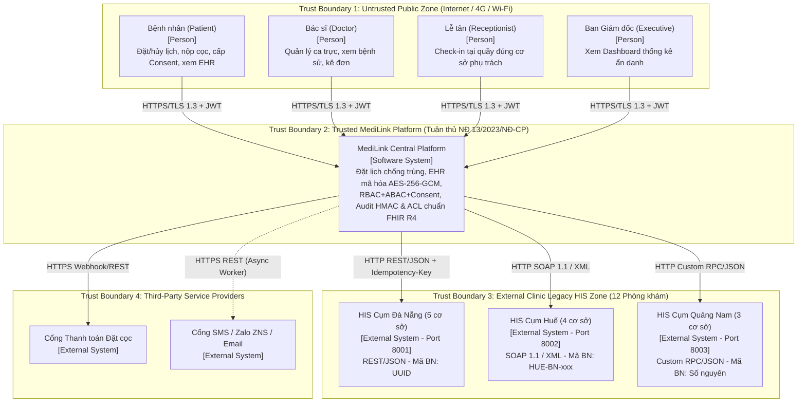
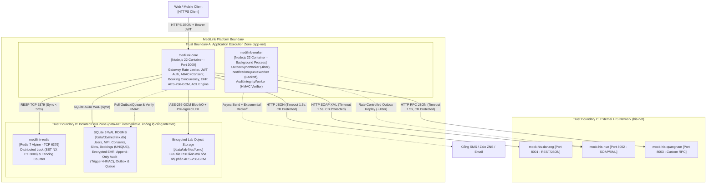
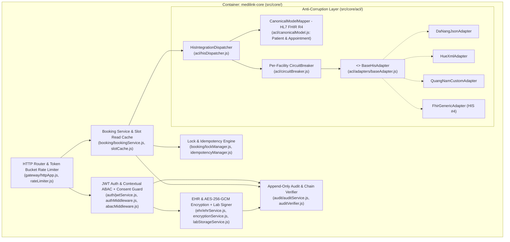
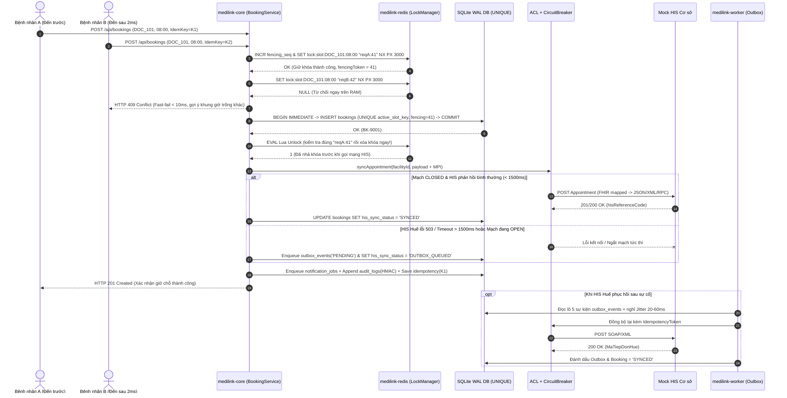
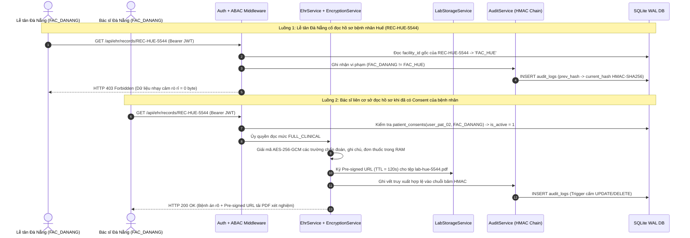

# Mốc M2 – Thiết kế Kiến trúc (Architecture Design): Hệ thống MediLink

- **Môn học:** SE 403 – Thiết kế Kiến trúc Phần mềm
- **Đề tài 1:** MediLink – Nền tảng đặt lịch khám và hồ sơ sức khỏe điện tử
- **Sản phẩm bàn giao M2:** Lựa chọn Tactics theo Bass et al. cho từng ASR, Thiết kế chống Double-Booking, Thiết kế lớp Tích hợp HIS & chế độ Đồng bộ/Bất đồng bộ từng luồng, Bảng so sánh Phong cách Kiến trúc Tổng thể, Hệ thống Khung nhìn C4 (Context, Container, Component), Deployment View, 2 Sequence Diagrams và Danh mục ADRs.

---

## 1. Lựa chọn Chiến thuật Kiến trúc cho từng ASR (Architectural Tactics – Bước 7)

Nhóm tham chiếu danh mục chiến thuật chuẩn trong *Software Architecture in Practice (4th Edition – Len Bass, Paul Clements, Rick Kazman)* để đối chiếu các phương án và chọn giải pháp tối ưu cho 4 ASR mức `(H, H)`.

### 1.1. Thiết kế Chống Double-Booking cho `ASR-01` (MediLink Mục 4)

**Yêu cầu mục tiêu:** 50 bệnh nhân cùng đặt 1 khung giờ của 1 bác sĩ → đúng 1 thành công (`201`), 49 nhận `409 Conflict`, `double-booking = 0.00%`, `p95 ≤ 500 ms`, chống gửi lặp khi rớt mạng (`Idempotency`).

#### Bảng So sánh 4 Cơ chế Kiểm soát Đồng thời Bắt buộc

| Cơ chế ứng viên | Thuộc nhóm Tactic (Bass et al.) | Ưu điểm | Nhược điểm & Kịch bản thất bại với 50 requests đồng thời |
|:---|:---|:---|:---|
| **1. Pessimistic Lock (`SELECT ... FOR UPDATE`)** | *Locking / Serialization* tại CSDL | Đảm bảo tuần tự hóa chặt chẽ trong phạm vi 1 CSDL quan hệ đơn. | Giữ kết nối và khóa dòng trong suốt giao dịch; nếu vô tình gọi HTTP sang HIS trong khi đang giữ khóa DB sẽ làm cạn kiệt Connection Pool ngay lập tức và tăng vọt độ trễ. |
| **2. Optimistic Lock (`version` column)** | *Concurrency Control* không khóa khi đọc | Tốc độ đọc rất cao khi ít xung đột. | **Thất bại nặng khi tranh chấp 50 chọi 1:** cả 50 luồng đều chạy qua các bước kiểm tra rồi 49 luồng đụng lỗi lệch `version` ở bước cuối; nếu client tự retry sẽ tạo bão truy vấn (*Retry Storm*). |
| **3. Chỉ dùng `UNIQUE(doctor_id, slot_time)` trên DB** | *Data Integrity Constraint* | Đơn giản, chốt chặn dữ liệu cuối cùng rất chắc chắn trên đĩa. | **Chưa đủ khi có nhiều instance, cache và HIS ngoài:** toàn bộ 50 requests dội thẳng vào DB; không ngăn được việc gọi trùng sang HIS trước khi commit; không xử lý được `Idempotency` khi cùng 1 khách bấm lặp. |
| **4. Distributed Lock trên Redis (`SET NX PX` + Lua)** | *Introduce Concurrency Broker / Token Lock* | Chặn sớm 49 requests tranh chấp ngay trên RAM trong `< 5 ms`, bảo vệ hoàn toàn CSDL bên dưới. | **Rủi ro nếu đứng một mình:** Nếu tiến trình giữ khóa bị treo (*GC pause*) lâu hơn TTL 3 giây thì khóa tự mở cho người thứ hai vào, hoặc nếu Redis khởi động lại mất khóa tạm thời có thể lọt 2 luồng xuống DB. |

#### Giải pháp Kiến trúc Nhóm Lựa chọn (`ADR-003` – Phòng thủ Đa tầng 3 Lớp)
Thay vì dựa đơn độc vào một cơ chế, nhóm kết hợp **3 lớp bổ trợ chặt chẽ** trong `src/core/booking/`:
1. **Lớp 1 – `Idempotency Key` (`idempotencyManager.js`):** Kiểm tra header `X-Idempotency-Key`; nếu khách hàng gửi lặp lại cùng một giao dịch do mạng 4G chập chờn, hệ thống trả về ngay kết quả đã lưu (`200 OK`, `idempotent_replay: true`).
2. **Lớp 2 – `Redis Distributed Lock + Monotonic Fencing Token` (`lockManager.js`):** Gọi lệnh nguyên tử `INCR medilink:fencing_seq` và `SET lock:slot:{doctor_id}:{slot_time} {owner}:{fencingToken} NX PX 3000`. 49 yêu cầu đến sau nhận `NULL` từ Redis và trả `HTTP 409 Conflict` tức thì. **Nguyên tắc vàng:** Khóa được giải phóng bằng **Lua Script nguyên tử** ngay sau khi bước ghi giữ chỗ xuống CSDL hoàn tất (chỉ giữ khóa `~2–5 ms`, **không bao giờ giữ khóa trong lúc chờ gọi HTTP sang HIS ngoài**!).
3. **Lớp 3 – `RDBMS Atomic Transaction + UNIQUE(active_slot_key)` (`database.js`):** Giao dịch `BEGIN IMMEDIATE` kiểm tra `slots.status == 'AVAILABLE'` và chèn vào `bookings` với cột khóa duy nhất `active_slot_key = doctor_id || '|' || slot_time` (khi hủy lịch thì gán `NULL` để tái sử dụng được slot). Đây là chốt chặn thép cuối cùng ngay cả khi Redis gặp sự cố.

> **Tự kiểm tra Bước 7 (`ASR-01`) – Tactic đã chọn ảnh hưởng tiêu cực tới QA nào khác?**
> - Làm tăng nhẹ **độ phức tạp vận hành (Maintainability/Deployability)** do phải duy trì thêm cụm Redis bên cạnh CSDL chính, và tăng khoảng `1–3 ms` độ trễ cho trường hợp không có tranh chấp. Tuy nhiên đánh đổi này hoàn toàn xứng đáng để đổi lấy `0.00%` double-booking và bảo vệ CSDL dưới đỉnh tải 50x.

---

### 1.2. Thiết kế Lớp Tích hợp HIS & Cô lập Sự cố cho `ASR-02` và `ASR-04` (MediLink Mục 3)

**Yêu cầu mục tiêu:** Liên thông 3 nhóm HIS không đồng nhất (Đà Nẵng REST/JSON, Huế SOAP/XML, Quảng Nam Custom RPC), thêm HIS thứ 4 trong `≤ 2 tuần công` với `0 dòng` sửa Core (`ASR-04`), và khi HIS Huế sập 2 giờ thì 11 cơ sở khác vẫn đặt lịch `100%` bình thường (`ASR-02`).

#### Bảng So sánh 3 Chiến lược Thiết kế Lớp Tích hợp Bắt buộc

| Chiến lược tích hợp | Mức tách biệt (*Decoupling*) | Đánh giá khả năng mở rộng HIS thứ 4 & Bảo vệ Core Domain |
|:---|:---:|:---|
| **1. Gọi trực tiếp từng HIS từ Core (*Direct Point-to-Point*)** | Rất thấp | `BookingService` chứa đầy `if (his == 'HUE') buildSoapXml() else if (his == 'QN') ...`. Khi thêm HIS thứ 4 hoặc sửa 1 thẻ XML ở Huế phải sửa và test lại toàn bộ Core. **Loại bỏ.** |
| **2. *Adapter per HIS* (Ánh xạ thẳng vào Model Nội bộ, không có Canonical Model)** | Trung bình | Đã tách giao thức HTTP/SOAP ra các class Adapter, nhưng mỗi Adapter lại phụ thuộc chặt vào cấu trúc bảng nội bộ của MediLink và tự xử lý quy đổi mã bệnh nhân một kiểu riêng. Khi MediLink nâng cấp model nội bộ hoặc cần trao đổi chuẩn y tế quốc gia thì mọi Adapter đều phải sửa. **Không tối ưu.** |
| **3. *Anti-Corruption Layer (ACL) + Canonical Data Model chuẩn HL7 FHIR R4 (`Patient`, `Appointment`)* *(Được chọn)*** | **Rất cao** | Tách biệt 2 chiều hoàn chỉnh: (1) Ánh xạ định danh xuyên chuỗi `MPI` ↔ mã bệnh nhân cục bộ (`patient_his_mappings`); (2) Chuẩn hóa sang tài nguyên y tế quốc tế **HL7 FHIR R4 `Patient` & `Appointment`** (`canonicalModel.js`); (3) Mỗi HIS chỉ cần 1 Adapter mỏng dịch từ FHIR sang giao thức đích, bọc ngoài bởi `CircuitBreaker` riêng từng cơ sở. **Tối ưu nhất.** |

#### Bảng Quyết định Chế độ Đồng bộ (*Synchronous*) hay Bất đồng bộ (*Asynchronous*) cho Từng Luồng Nghiệp vụ

| STT | Luồng giao tiếp tích hợp | Chế độ lựa chọn | Giao thức & Cơ chế kỹ thuật | Lý do kiến trúc đằng sau quyết định |
|:---:|--------------------------|:---------------:|-----------------------------|-------------------------------------|
| 1 | **Tra cứu danh sách Bác sĩ & Khung giờ trống** (`Client → MediLink`) | **Đồng bộ trên Cache/DB nội bộ** *(Không gọi HIS trực tiếp)* | `HTTP GET` → `SlotReadCache` (TTL 15s, xóa đệm khi ghi) → `SQLite` | Nếu mỗi lượt bệnh nhân mở màn hình chọn lịch đều gọi sang 3 HIS ngoài thì độ trễ tăng gấp 10 lần và khi HIS Huế sập khách không xem được cả lịch trống. |
| 2 | **Đặt lịch khám mới** (`MediLink → HIS Cơ sở`) | **Lai thông minh (*Hybrid: Sync có Timeout ngắn + Fallback sang Async Outbox*)** | Khi mạch `CLOSED`: gọi đồng bộ `Timeout = 1.5s` để lấy mã phiếu HIS ngay. Khi lỗi/timeout hoặc mạch `OPEN`: ghi **bất đồng bộ** vào `outbox_events` (`ADR-007`). | Khi HIS khỏe (99% thời gian), bệnh nhân nhận được ngay mã phiếu tiếp đón của phòng khám; khi HIS Huế sập 2 giờ, hệ thống tự động chuyển sang bất đồng bộ để không treo luồng và không mất lịch! |
| 3 | **Đồng bộ bù lịch hẹn sau sự cố** (`Worker → HIS Cơ sở`) | **Bất đồng bộ có điều tiết nhịp độ** (*Asynchronous Rate-Controlled*) | `OutboxSyncWorker` đọc lô `5 bản ghi` + chèn `Jitter` ngẫu nhiên + `IdempotencyToken` | Ngăn chặn triệt để hiện tượng *Thundering Herd* làm máy chủ HIS di sản tại Huế vừa khởi động lại đã bị dội sập tiếp. |
| 4 | **Đẩy kết quả xét nghiệm PDF/ảnh & tóm tắt khám từ HIS lên MediLink** | **Bất đồng bộ** (*Asynchronous*) | Webhook / Batch Upload nền → mã hóa `AES-256-GCM` lưu vào Object Storage (`ADR-006`) | Tệp xét nghiệm nặng 1–15 MB và phát sinh sau giờ khám; xử lý bất đồng bộ giúp không làm nghẽn băng thông luồng đặt lịch trực tuyến. |
| 5 | **Gửi thông báo xác nhận QR & nhắc lịch 24h/2h (SMS, Zalo ZNS, Email)** | **Bất đồng bộ hoàn toàn** (*Asynchronous Queue*) | Bảng hàng đợi `notification_jobs` + `NotificationQueueWorker` retry hàm mũ 3 lần (`ADR-005`) | Độ trễ và sự cố của nhà mạng viễn thông bên ngoài phải được cách ly 100% khỏi giao dịch đặt lịch (`QAS-08`). |

> **Tự kiểm tra Bước 7 (`ASR-02` & `ASR-04`) – Tactic đã chọn ảnh hưởng tiêu cực tới QA nào khác?**
> - **Circuit Breaker + Outbox (`ASR-02`):** Đánh đổi **Tính nhất quán tức thời (*Immediate Consistency*)** lấy **Tính sẵn sàng (*Availability*)** — trong thời gian HIS Huế đứt mạng, phần mềm tại quầy Huế chưa thấy ngay lịch mới đặt trên mây cho tới khi mạng có lại và Outbox đồng bộ xong.
> - **ACL + HL7 FHIR Canonical Model (`ASR-04`):** Tăng nhẹ **chi phí chuyển đổi dữ liệu (*Serialization Overhead*)** khoảng `1–2 ms` CPU để tạo cấu trúc JSON FHIR R4 trung gian, nhưng hoàn toàn không đáng kể so với lợi ích bảo trì dài hạn.

---

### 1.3. Thiết kế Bảo mật Đa lớp cho `ASR-03` & `QAS-05` (MediLink Mục 5)

Nhóm áp dụng tổ hợp **5 Tactics bảo mật** từ catalog của Bass et al. (`Authenticate Actors`, `Authorize Actors`, `Limit Access / Data Minimization`, `Encrypt Data`, `Maintain Audit Trail` + `Detect Intrusion/Tampering`):
1. **Xác thực `JWT HS256` chuẩn RFC 7519 (`jwtService.js`):** Kiểm tra chữ ký số bằng `crypto.timingSafeEqual` và thời hạn `exp`.
2. **Phân quyền `RBAC + Contextual ABAC + Explicit Consent` (`abacMiddleware.js`):**
   - Kiểm tra vai trò (`PATIENT`, `RECEPTIONIST`, `DOCTOR`, `DIRECTOR`, `ADMIN`).
   - Đối với `RECEPTIONIST`: bắt buộc đối chiếu `user.facility_id === record.facility_id` lấy trực tiếp từ bản ghi trong CSDL (chặn đứng `403` nếu khác cơ sở); ngay cả khi đúng cơ sở, chỉ cấp phạm vi xem `ADMIN_SUMMARY_ONLY` (ẩn toàn bộ chẩn đoán và đơn thuốc).
   - Đối với `DOCTOR` khác cơ sở: bắt buộc kiểm tra bệnh nhân đã cấp quyền trong `patient_consents` hay chưa.
3. **Mã hóa cấp trường `AES-256-GCM` (`encryptionService.js`):** Mã hóa toàn bộ các cột nhạy cảm (`diagnosis_enc`, `clinical_notes_enc`, `prescription_enc`, `lab_summary_enc`) với IV 96-bit ngẫu nhiên và khóa tách biệt khỏi CSDL.
4. **Kho Object Storage mã hóa + Pre-signed URL 120s (`labStorageService.js` – `ADR-006`):** Bảo vệ tệp PDF kết quả xét nghiệm.
5. **Audit Log chỉ ghi thêm (*Append-only*) kép (`auditService.js`, `auditVerifier.js`):** Cài đặt **SQLite Trigger chặn `UPDATE`/`DELETE`** ở tầng CSDL kết hợp **Chuỗi băm mật mã liên hoàn `HMAC-SHA256`** từ khối khởi nguyên (`GENESIS_HASH`) để phát hiện cả hành vi can thiệp của Root DBA.

---

## 2. So sánh & Lựa chọn Phong cách Kiến trúc Tổng thể (Bước 8 & `ADR-001`)

| Tiêu chí đánh giá (Truy vết ASR & Ràng buộc) | Trọng số | PA1: Layered Monolith truyền thống | PA2: Microservices phân tán (tách cả từng HIS) | PA3: Modular Monolith + Hexagonal + Worker tách rời *(Chọn)* |
|:---|:---:|:---:|:---:|:---:|
| **`ASR-01` – Chống Double-Booking & Nhất quán dữ liệu** | 25% | 3.5 / 5 | 2.5 / 5 *(Phức tạp giao dịch phân tán giữa các service)* | **5.0 / 5** *(Khóa Redis + Giao dịch ACID nội bộ siêu nhanh)* |
| **`ASR-02` – Cô lập lỗi HIS Huế & Xử lý nền bền vững** | 25% | 2.0 / 5 *(Chung luồng dễ treo cả khối)* | **5.0 / 5** *(Cách ly tiến trình hoàn toàn)* | **4.5 / 5** *(Circuit Breaker theo cơ sở + Container `medilink-worker` riêng)* |
| **`ASR-03` – Bảo mật ABAC, Consent & Audit bất biến** | 20% | 3.0 / 5 *(Dễ gọi tắt qua tầng Repository)* | 3.5 / 5 *(Phải đồng bộ chính sách/token qua nhiều trạm)* | **4.8 / 5** *(Cổng kiểm soát ABAC & Mã hóa tập trung, nhất quán 100%)* |
| **`ASR-04` – Tích hợp thêm HIS thứ 4 ≤ 2 tuần công** | 15% | 2.0 / 5 *(Dính chặt giao thức ngoài vào Service)* | 4.5 / 5 *(Viết thêm 1 connector service mới)* | **5.0 / 5** *(Cắm thêm 1 class Adapter qua Port `BaseHisAdapter`, sửa Core = 0)* |
| **`C-07` – Tính khả thi cho nhóm 4 sinh viên trong 15 tuần** | 15% | **5.0 / 5** | 1.5 / 5 *(Quá tải DevOps, mạng, nhiều DB, tốn RAM)* | **4.8 / 5** *(6 containers nhẹ < 250MB RAM, cấu trúc code cực kỳ rõ ràng)* |
| **ĐIỂM TỔNG HỢP CÓ TRỌNG SỐ** | **100%** | **2.98 / 5.0** | **3.38 / 5.0** | **4.81 / 5.0 (LỰA CHỌN TỐI ƯU)** |

### Góc nhìn Phản biện (*Devil's Advocate*): Khi nào lựa chọn Modular Monolith này trở nên bất cập?
- **Phản biện:** *"Nếu chuỗi MediLink sáp nhập lên 100 bệnh viện toàn quốc với 50.000 lượt khám/giờ và 20 đội kỹ sư cùng code chung 1 repo `medilink-core`, việc deploy chung một khối có gây nghẽn quy trình phát hành và nghẽn tải ghi CSDL đơn không?"*
- **Trả lời trung thực của nhóm:** Có! Nhưng ở quy mô hiện tại (12 phòng khám, ~2.000 lượt/ngày, nhóm 4 người trong 15 tuần), xây dựng 10 Microservices ngay từ đầu là lỗi thiết kế *Premature Optimization* kinh điển. Nhờ nhóm đã phân chia ranh giới module khép kín (`auth`, `booking`, `ehr`, `acl`, `audit`) và chuẩn hóa giao diện `BaseHisAdapter` theo Hexagonal Architecture, khi quy mô tăng gấp 10–20 lần trong tương lai, nhóm có thể tách riêng module `acl` (HIS Integration Service) và `booking` ra thành các Microservices độc lập chỉ trong vài ngày mà không phải viết lại logic nghiệp vụ.

---

## 3. Các Khung nhìn Kiến trúc (Architecture Views – Bước 9)

Toàn bộ 6 sơ đồ dưới đây được duy trì đồng bộ dạng mã nguồn C4-PlantUML trong thư mục `diagrams/` và biểu diễn trực quan bằng Mermaid dưới đây. **Tên mọi thành phần, cổng mạng và giao thức khớp 100% giữa các View và khớp 1:1 với mã nguồn `src/` cùng `docker-compose.yml`.**

### 3.1. C4 Level 1 – System Context View (Kèm Trust Boundaries)
*(Mã nguồn gốc PlantUML: [`diagrams/c4-context.puml`](../diagrams/c4-context.puml))*

- **Legend (Chú giải):** Nét liền (`-->`) biểu diễn luồng gọi trực tuyến có kiểm soát thời gian chờ; nét đứt (`-.->`) biểu diễn luồng xử lý nền bất đồng bộ; khung chữ nhật bao ngoài thể hiện **4 Ranh giới Tin cậy (*Trust Boundaries*)** nơi mọi gói tin đi qua đều phải xác thực/kiểm tra hợp lệ.

---

### 3.2. C4 Level 2 – Container View (Kèm Trust Boundaries, Khớp 1:1 với `docker-compose.yml`)
*(Mã nguồn gốc PlantUML: [`diagrams/c4-container.puml`](../diagrams/c4-container.puml))*

- **Legend & Giải thích Khung nhìn Container:**
  - Mạng `data-net` được cấu hình `internal: true` trong `docker-compose.yml`, đảm bảo `medilink-redis` và volume dữ liệu `/data` tuyệt đối không thể bị kết nối trực tiếp từ bên ngoài Host hay từ vùng mạng HIS.
  - Mọi kết nối từ `medilink-core` sang `mock-his-*` đều có ngân sách thời gian cứng `1.500 ms` và bộ ngắt mạch riêng biệt.

---

### 3.3. C4 Level 3 – Component View bên trong `medilink-core` & Lớp Anti-Corruption Layer
*(Mã nguồn gốc PlantUML: [`diagrams/c4-component-acl.puml`](../diagrams/c4-component-acl.puml))*

- **Legend:** Đường nét liền (`-->`) là lời gọi hàm phụ thuộc trong tiến trình (*In-process dependency*); đường nét đứt (`-.->`) là quan hệ kế thừa/hiện thực hóa giao diện cổng trừu tượng `BaseHisAdapter` (tuân thủ nguyên tắc Đảo ngược Phụ thuộc – *Dependency Inversion*).

---

### 3.4. Deployment View (Khung nhìn Triển khai Hạ tầng Container)
*(Mã nguồn gốc PlantUML: [`diagrams/deployment-view.puml`](../diagrams/deployment-view.puml))*

| Node / Container trong `docker-compose.yml` | Base Image | Mạng kết nối (*Docker Networks*) | Cổng mở ra Host | Vai trò triển khai thực tế |
|:---|:---:|:---|:---:|:---|
| `medilink-core` | `node:22-alpine` | `app-net`, `data-net`, `his-net` | `3000:3000` | Cổng vào API duy nhất của nền tảng MediLink. |
| `medilink-worker` | `node:22-alpine` | `app-net`, `data-net`, `his-net` | *Không mở cổng* | Chạy ngầm đồng bộ bù Outbox, gửi tin nhắc lịch và kiểm định chuỗi băm Audit. |
| `medilink-redis` | `redis:7-alpine` | Chỉ `data-net` (`internal: true`) | *Không mở cổng* | Cấp khóa phân tán nguyên tử và bộ đếm `fencing_seq` có bật lưu đĩa AOF mỗi giây. |
| Volume `medilink_storage` | Docker Volume `/data` | Gắn vào `core` & `worker` | *Nội bộ* | Chứa tệp CSDL quan hệ `medilink.db` (chế độ WAL) và kho tệp xét nghiệm mã hóa `/data/lab-files/*.enc`. |
| `mock-his-danang` | `node:22-alpine` | `his-net` | `8001:8001` | Giả lập máy chủ HIS cụm Đà Nẵng (`REST/JSON`). |
| `mock-his-hue` | `node:22-alpine` | `his-net` | `8002:8002` | Giả lập máy chủ HIS cụm Huế (`SOAP/XML`); cho phép chạy `docker stop mock-his-hue` để test đứt kết nối thật! |
| `mock-his-quangnam` | `node:22-alpine` | `his-net` | `8003:8003` | Giả lập máy chủ HIS cụm Quảng Nam (`Custom RPC/JSON`). |

---

### 3.5. Sequence Diagram 1 – Luồng Đặt lịch Chống Double-Booking & Dự phòng Outbox (`ASR-01` & `ASR-02`)
*(Mã nguồn gốc PlantUML: [`diagrams/sequence-booking-concurrency.puml`](../diagrams/sequence-booking-concurrency.puml))*

---

### 3.6. Sequence Diagram 2 – Luồng Phân quyền ABAC, Consent, Giải mã `AES-256-GCM` & Audit HMAC (`ASR-03` & `QAS-05`)
*(Mã nguồn gốc PlantUML: [`diagrams/sequence-security-audit.puml`](../diagrams/sequence-security-audit.puml))*

---

## 4. Danh mục Tổng hợp 7 Quyết định Kiến trúc (ADR Index – Bước 10)

| Mã ADR | Tệp chi tiết trong `adr/` | Trạng thái | Quyết định cốt lõi & Truy vết ASR |
|:------:|---------------------------|:----------:|-----------------------------------|
| **`ADR-001`** | [`0001-architectural-style.md`](../adr/0001-architectural-style.md) | `Accepted` | Chọn **Modular Monolith + Hexagonal Architecture** kèm tiến trình `medilink-worker` tách rời (`ASR-01`, `ASR-02`, `ASR-04`, `C-07`). |
| **`ADR-002`** | [`0002-his-integration-acl-canonical-model.md`](../adr/0002-his-integration-acl-canonical-model.md) | `Partially Superseded by ADR-007` | Tích hợp 3 HIS qua **Anti-Corruption Layer + Canonical Model chuẩn HL7 FHIR R4 (`Patient`, `Appointment`)** và bảng ánh xạ `MPI` (`ASR-04`). |
| **`ADR-003`** | [`0003-concurrency-distributed-locking-idempotency.md`](../adr/0003-concurrency-distributed-locking-idempotency.md) | `Accepted` | Chống double-booking 3 lớp: **Idempotency Key + Redis Lock (`SET NX PX` + Fencing Token, nhả sớm) + RDBMS `UNIQUE`** (`ASR-01`, `QAS-07`). |
| **`ADR-004`** | [`0004-security-rbac-facility-scope-immutable-audit.md`](../adr/0004-security-rbac-facility-scope-immutable-audit.md) | `Accepted` | Bảo mật y tế: **JWT HS256 + RBAC/ABAC/Consent + Data Masking + Mã hóa `AES-256-GCM` + Trigger & HMAC Audit Chain** (`ASR-03`, `QAS-05`). |
| **`ADR-005`** | [`0005-asynchronous-notification-queue.md`](../adr/0005-asynchronous-notification-queue.md) | `Accepted` | Gửi thông báo nhắc lịch Zalo/SMS/Email bất đồng bộ qua **Persistent Queue + Worker có Exponential Backoff & DLQ** (`QAS-08`). |
| **`ADR-006`** | [`0006-lab-result-object-storage-presigned-url.md`](../adr/0006-lab-result-object-storage-presigned-url.md) | `Accepted` | Lưu tệp PDF/ảnh xét nghiệm trên **Encrypted Object Storage tách rời DB + Pre-signed URL ngắn hạn 120s** (`ASR-03`, `QAS-06`). |
| **`ADR-007`** | [`0007-v2-outbox-rate-controlled-recovery.md`](../adr/0007-v2-outbox-rate-controlled-recovery.md) | `Accepted (v2)` | Nâng cấp xử lý lỗi HIS ở M3: **Per-Facility Circuit Breaker + Transactional Outbox + Rate-Controlled Sync có Jitter** (`ASR-02`). |

> **Tự kiểm tra Bước 9 & Bước 10:**
> 1. **Chỉ vào mũi tên từ `medilink-core` sang `mock-his-hue`:** Giao thức là `HTTP POST` mang gói tin `SOAP 1.1 / XML` trên cổng `8002`; chế độ gọi là **đồng bộ có giới hạn thời gian cứng `1.500 ms`** khi mạch `CLOSED`. Nếu `mock-his-hue` sập hoặc treo quá `1.500 ms` 3 lần liên tiếp, `CircuitBreaker(FAC_HUE)` mở mạch `OPEN`, mọi yêu cầu tiếp theo không gửi gói tin mạng nữa mà ghi thẳng vào bảng `outbox_events` trong `< 10 ms` để `medilink-worker` đồng bộ bù về sau.
> 2. **Nếu bối cảnh thay đổi – tải tăng gấp 10 lần (120 cơ sở, 25.000 lịch hẹn/ngày), ADR nào sẽ bị thay thế trước?**
>    - Trước tiên là nâng cấp hạ tầng lưu trữ dưới `ADR-001` & `ADR-005`: chuyển CSDL từ SQLite WAL trên 1 volume sang cụm **PostgreSQL Primary + Read Replicas** và chuyển hàng đợi công việc sang **Redis Cluster / RabbitMQ** để chạy nhiều replica `medilink-core` song song phía sau Load Balancer; tiếp đó có thể trích xuất riêng module `acl` thành dịch vụ tích hợp độc lập nhờ giao diện `BaseHisAdapter` đã tách sẵn.
